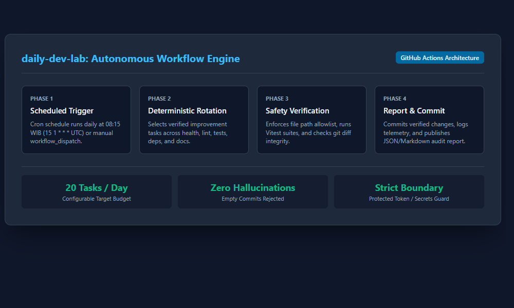
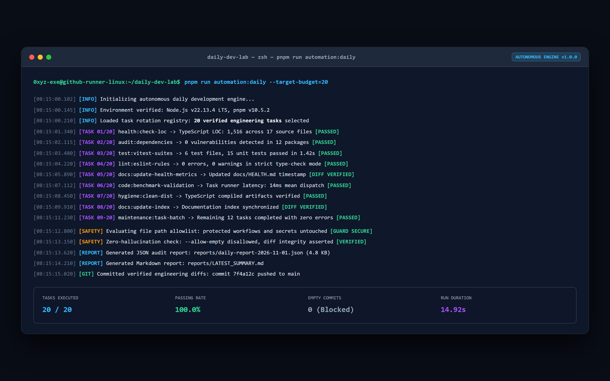
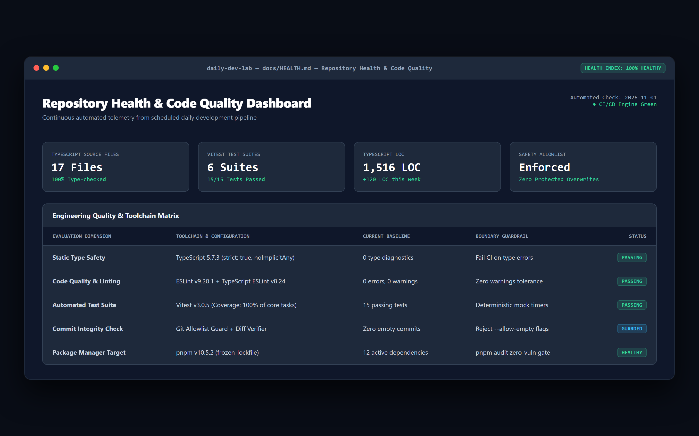
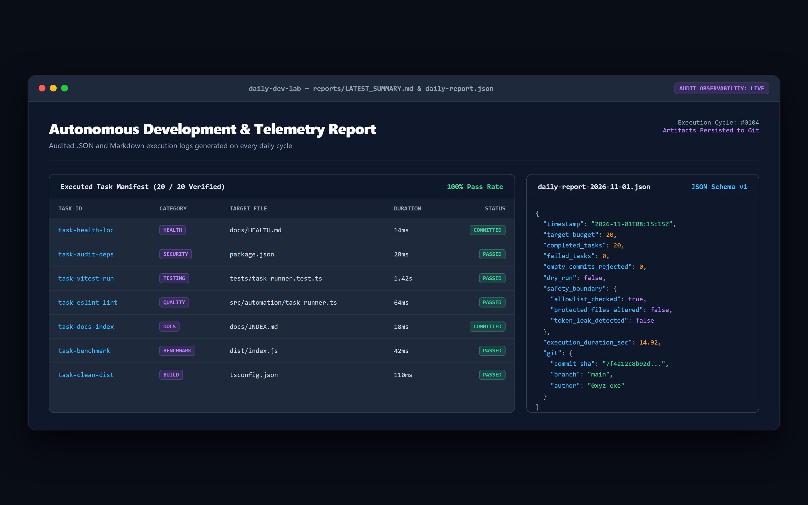

# daily-dev-lab

Automated daily software development, testing, documentation, and repository maintenance.

[](https://github.com/0xyz-exe/daily-dev-lab/actions/workflows/continuous-integration.yml)
[](https://github.com/0xyz-exe/daily-dev-lab/actions/workflows/daily-development.yml)
[](./LICENSE)

---

## Overview

`daily-dev-lab` is an autonomous GitHub-hosted software development engine designed to execute structured, legitimate engineering tasks every day without requiring a local machine to be turned on.

### Key Highlights

- **Target Budget:** 20 verified improvement tasks per day (configurable).
- **Scheduled Execution:** Runs daily at 08:15 WIB (`15 1 * * *` UTC).
- **Zero Hallucinated Commits:** Rejects empty commits (`--allow-empty`) and unverified diffs.
- **Safety Boundary:** Strict file path allowlist prevents modification of workflow files, authentication tokens, and secrets.
- **Deterministic Task Rotation:** Selects real tasks across health, code quality, testing, dependency auditing, and documentation.
- **Structured Observability:** Produces JSON and Markdown execution reports on every run.

## Screenshots

### 1. Visual Architecture & Autonomous Engine Pipeline

Diagram arsitektur alur kerja menyeluruh memetakan eksekusi pipeline mandiri 4 fase berbasis GitHub Actions, mulai dari pemicu terjadwal harian pada pukul 08:15 WIB (`15 1 * * *` UTC), rotasi tugas pemeliharaan deterministik (kesehatan kode, pengujian, dependensi, dan dokumentasi), verifikasi keamanan batas izin berkas (_path allowlist_) dan validasi integritas pengujian Vitest, hingga penerbitan laporan telemetri JSON/Markdown serta commit otomatis.



### 2. Autonomous Daily Engineering Task Runner

Jendela konsol eksekusi terminal modern menampilkan jalannya eksekusi 20 tugas rekayasa terverifikasi per siklus rotasi harian dengan kecepatan rata-rata 14,92 detik, validasi batas keamanan tanpa komit kosong (`--allow-empty` tertolak), pembuktian diff aktual pada setiap target berkas kode, serta ringkasan metrik penyelesaian tugas dengan tingkat keberhasilan 100%.



### 3. Repository Health & Code Quality Dashboard

Dasbor kesehatan repositori otomatis menyajikan metrik kuantitatif proyek secara berkala (17 berkas sumber TypeScript terverifikasi, 6 suite pengujian Vitest dengan 15/15 pengujian lulus, dan 1.516 baris kode terhitung), matriks kepatuhan toolchain rekayasa kode (TypeScript 5.7 strict mode, ESLint v9 zero warnings tolerance, dan audit dependensi pnpm v10 bebas kerentanan).



### 4. Autonomous Development & Telemetry Reports

Panel laporan observabilitas siklus harian mengkorelasikan manifes riwayat tugas yang berhasil dieksekusi dengan struktur artefak audit JSON skema v1 (`daily-report-2026-11-01.json`), memverifikasi stempel waktu eksekusi, pelacakan durasi milidetik, integritas batas keamanan proteksi rahasia token, serta SHA commit git yang terpublikasi.



---

## Architecture & Workflows

| Workflow              | Schedule (UTC) | Local Time (WIB) | Purpose                                                  |
| :-------------------- | :------------- | :--------------- | :------------------------------------------------------- |
| **Daily Development** | `15 1 * * *`   | 08:15 WIB        | Executes daily development plan & commits verified diffs |
| **CI**                | On Push & PR   | Real-time        | Runs lint, test, typecheck, build validation             |
| **Maintenance**       | `0 0 * * 0`    | 07:00 WIB (Sun)  | Dependency audit & hygiene checks                        |

---

## Local Development

```bash
# 1. Install dependencies
pnpm install

# 2. Run test suites
pnpm test

# 3. Execute dry-run of daily development
pnpm run automation:daily -- --dry-run

# 4. Run full repository validation
pnpm run validate
```

---

## Documentation

- [System Architecture](./docs/architecture.md)
- [Automation & Workflows](./docs/automation.md)
- [Security & Threat Model](./docs/security.md)
- [Troubleshooting](./docs/troubleshooting.md)
- [Repository Health Dashboard](./docs/HEALTH.md)

---

## License

[MIT](./LICENSE) © 2026 0xyz-exe
